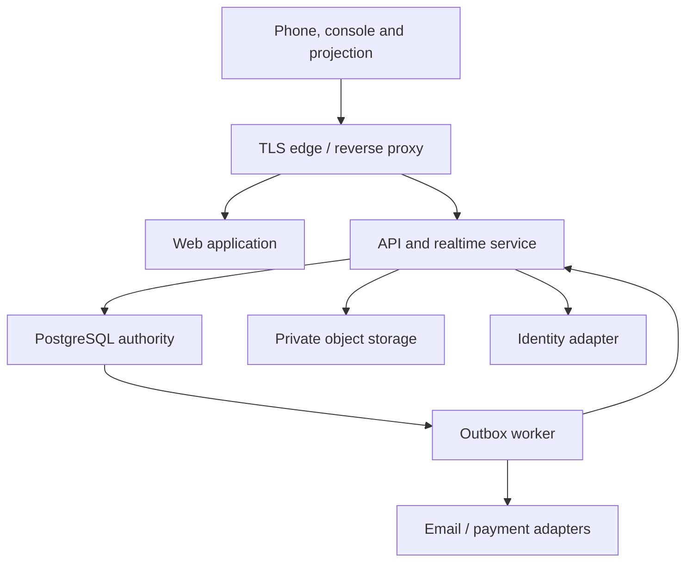

# MSN Cricket Auction Platform
## Detailed Solution Architecture · v1.1 · 12 November 2026

Read with MSN_Cricket_PRD.md. Technology stack approved by the product owner. Remaining proposed defaults are identified in the PRD. This describes the intended implementation, not the current demo.

## 1. Architecture decision
Use a modular TypeScript application with a Next.js/React web interface with Tailwind CSS and accessible components, a long-running NestJS API/realtime service on Node.js, PostgreSQL as the authoritative store, object storage for photos/logos and a background worker for reliable event delivery and notifications. Deploy in an India region where the selected providers support the required services. Keep frontend and backend contracts explicit. No microservice fleet or Kubernetes is needed for the first release.

| Approach | Benefit | Tradeoff | Decision |
|---|---|---|---|
| Browser-only state | Fast design experiments | Cannot enforce shared bids, persistence or identity | Existing demo only |
| Managed database + thin serverless CRUD | Low operational effort | Auction commands, realtime delivery and recovery still need a consistent authority | Viable alternative with custom command service |
| Modular backend + PostgreSQL + persistent realtime | Clear transaction boundary, replay and operational control | Requires managed runtime and monitoring | Recommended |

Approved stack: TypeScript across web and backend; Next.js + React for web, Tailwind CSS for styling, NestJS for the persistent API and Socket.IO gateways, PostgreSQL for authoritative data, and S3-compatible object storage. Use managed containers for the persistent backend and managed PostgreSQL. Redis is optional when multiple backend replicas need fanout; it is not an initial correctness dependency.

Pin supported dependency versions when implementation begins. Hosting provider and authentication provider remain replaceable adapters. Do not couple the auction engine to payment or messaging vendors.

## 2. Logical topology

Only API commands can change auction state. Realtime distributes committed facts. The browser is never the source of truth for balances, eligibility or current bids.

## 3. Modules and ownership
| Module | Responsibilities | Owns |
|---|---|---|
| Identity/access | Authentication, sessions, role grants, club membership, support elevation | Accounts, memberships, invitations |
| Clubs/branding | Tenant lifecycle, public identity, staff permissions | Clubs and settings |
| Registration | Player profiles, auction entry, manager applications, approval | Profiles, registrations, applications |
| Auction setup | Rules, teams, locking, readiness, rehearsals | Auctions, rules snapshots, teams |
| Auction command engine | Selection, bids, pause, close, settlement, reversal | Lots, bids, allocations, purse ledger |
| Realtime | Authorized rooms, snapshots, event cursor and resync | Connections, no authoritative business state |
| Commerce | Catalog, checkout, webhooks, credits, redemption | Orders, payments, entitlements |
| Reporting | Redacted public views, reconciliation, exports | Export jobs/read models |
| Operations | Audit, metrics, outbox delivery, retention | Audit records and job state |

## 4. Data model
All tenant-owned tables carry `club_id`; auction-owned tables also carry `auction_id`. Composite foreign keys or equivalent database constraints prevent cross-club references. UUID identifiers never substitute for access checks.

| Table | Important fields and constraints |
|---|---|
| users | id, identity_subject unique, verified_email, preferred_language |
| clubs | id, slug unique, name, branding_object_id, status |
| club_memberships | club_id, user_id, role; unique membership/role as appropriate |
| player_profiles | id, user_id, name, birth_date/private age data, contact, location, photo, role, styles |
| auctions | id, club_id, name, status, version, scheduled_at UTC, rules JSON snapshot, locked_at, started_at |
| registrations | id, club_id, auction_id, player_id, requested_base nullable, effective_base, approval_status; unique auction/player |
| manager_applications | auction_id, user_id, status, requested_team, reviewed_by, reason |
| teams | id, club_id, auction_id, code, name, initial_purse, remaining_purse; unique auction/code |
| team_operators | auction_id, team_id, user_id, active; partial unique active operator per team |
| lots | id, auction_id, registration_id, attempt, status, leading_bid_id, version; unique registration/attempt; partial unique active lot per auction |
| bids | id, auction_id, lot_id, team_id, user_id, amount, event_sequence, command_id; immutable accepted bids |
| allocations | id, auction_id, registration_id, team_id, lot_id, price, status; partial unique active allocation per registration |
| purse_ledger | team_id, delta, reason, allocation_id, reversal_of; unique reversal_of where present |
| commands | actor_id, command_id, request_hash, outcome; unique actor/command_id |
| auction_events | auction_id, sequence, type, payload, occurred_at; unique auction/sequence |
| outbox | event_id unique, delivery_status, retry_at, attempts |
| credit_products | SKU, count, amount_minor, currency, validity policy, active |
| orders/payments | club_id, SKU snapshot, provider reference unique, state, amount_minor |
| provider_events | provider, external_event_id unique, verification_status, processed_at |
| credit_grants | club_id, units, source, expiry, revoked_at, granted_by, reason |
| credit_redemptions | grant_id, auction_id unique, redeemed_at; consumed atomically |
| audit_log | actor, tenant, action, resource, reason, redacted before/after, server timestamp |

Index tenant/auction/status lookups and `(auction_id, sequence)` for replay. Store money as integer minor currency units and bids as integer points. Store timestamps in UTC and render scheduled/event times in Asia/Kolkata. Retain registration-time snapshots so later profile edits do not rewrite auction history.

## 5. Auction command transaction
For `placeBid`, receive authenticated actor, auction/lot ID, `commandId`, expected lot version and expected amount.

1. Validate schema/size and authenticate. Rate-limit by user and auction, independently of authorization.
2. Begin PostgreSQL transaction. Lock auction row, then active lot, then team row using the same order for all mutations.
3. Resolve club/auction membership and active operator assignment within the transaction. Check approved team, licensed started auction, open lot and unchanged version.
4. Check idempotency record. Same actor/command ID and request hash returns stored outcome; changed payload with reused ID is rejected.
5. Calculate next valid amount and maximum affordable bid from authoritative rules, allocations and purse. Reject own-team leading bid and ineligible/full squad.
6. Insert accepted bid, advance lot and auction sequence/version, write event, audit and outbox record, and record command outcome.
7. Commit. Only then acknowledge acceptance and broadcast the committed event. Timeout after commit is resolved by command-status lookup, not by a second bid with a new ID.

Serialize close, sell, recall and corrections through the same auction lock. At the initial scale this intentionally trades per-auction write parallelism for simple correctness. Different auctions use different locks. Set transaction/lock timeouts; safely retry deadlock/serialization failures with the same command ID. Never use SKIP LOCKED for auction bidding because silently skipping the active authority row would violate ordering.

PostgreSQL's row locks support this proposed serialization boundary; see https://www.postgresql.org/docs/current/explicit-locking.html .

## 6. State machines
Auction: DRAFT → REGISTRATION_OPEN → READY → LOCKED → LIVE ↔ PAUSED → COMPLETED → ARCHIVED. Explicit cancellation permitted before LIVE; in-progress abandonment is an audited administrative workflow. Roster/rule unlocking before start returns to readiness review; after start requires controlled amendment and a new rules version.

Lot: PREVIEW → OPEN ↔ PAUSED → CLOSED → SOLD or UNSOLD. CLOSED preserves the leading bid for confirmation. An operator can reopen a closed but unsettled lot only with a reason and a new version; this is visible to all clients. SOLD reversal creates compensating records, never deletes bids. A recalled UNSOLD registration gets a new lot attempt.

Registration: DRAFT → PENDING → APPROVED / REJECTED / CHANGES_REQUESTED; withdrawal allowed before lot opening. Manager application follows equivalent approval transitions. A platform suspension during an active event pauses new commands rather than erasing entitlements or results.

## 7. Realtime protocol and client correctness
Socket.IO is selected for delivery through NestJS gateways; room subscription requires authorization to the requested club/auction. Public projection uses a separate redacted stream. Event envelope includes `eventId`, `auctionId`, `sequence`, `lotVersion`, `type`, `occurredAt`, `payload`.

On connect: authenticate → authorized subscription → fetch snapshot with cursor → replay events after cursor → apply only contiguous sequences → enter synchronized state. A missing sequence, changed lot or failed recovery triggers fresh snapshot. Duplicate event IDs are ignored. Keep an event retention window and respond `RESYNC_REQUIRED` for expired cursors.

Socket transport alone is insufficient for reliable outcomes: default Socket.IO delivery is at most once. Application commands therefore use acknowledgments/idempotency, and events use durable replay. Sources: https://socket.io/docs/v4/delivery-guarantees/ and https://socket.io/docs/v4/tutorial/handling-disconnections/ .

Use HTTPS command endpoints for mutations and sockets for notifications; never implement two independent bid processors. Show reconnecting/stale state immediately, disable bid until fresh snapshot, and never queue offline bid submissions. A foregrounded phone resynchronizes before enabling controls. Losing connection after submission displays 'Checking bid result' and queries the original command ID.

## 8. API contract outline
| Endpoint | Authority / purpose |
|---|---|
| POST /clubs | Authenticated club creation |
| POST /clubs/:club/auctions | Club admin, draft configuration |
| POST /auctions/:id/registrations | Authenticated player, pending approval |
| POST /auctions/:id/manager-applications | Authenticated applicant |
| POST /registrations/:id/review | Club admin, review status/reason |
| POST /auctions/:id/teams | Club admin, team and operator invitations |
| POST /auctions/:id/lock | Club admin, readiness snapshot |
| POST /auctions/:id/start | Club admin, atomic credit redemption |
| POST /auctions/:id/commands | Authorized typed command: select/open/bid/pause/close/sell/unsold/recall/reverse |
| GET /auctions/:id/snapshot | Role-filtered current state + cursor |
| GET /auctions/:id/events?after=N | Authorized replay, bounded pages |
| GET /commands/:commandId | Owning actor/admin outcome lookup |
| GET /auctions/:id/public | Published redacted data |
| POST /billing/checkout | Club owner, immutable SKU checkout |
| POST /billing/webhooks/:provider | Raw-body signature verification, replay-safe processing |
| POST /platform/credit-grants | Platform operator, reason required |

Errors include stable code, user-facing translation key, retryability, command ID and current version where safe. Standard codes: UNAPPROVED, NOT_OPERATOR, AUCTION_PAUSED, LOT_CLOSED, STALE_VERSION, INSUFFICIENT_POINTS, SQUAD_FULL, CREDIT_REQUIRED, CONFLICT. Never leak another tenant's existence via detailed resource errors.

## 9. License and payment correctness
A payment return URL never grants a license. Verify signed provider webhooks against the raw request; deduplicate provider event IDs; validate merchant, amount, currency and internal order binding. Payment processing and credit issuance are one transaction. Failed/replayed notifications cannot issue duplicate credits. Reconciliation worker checks unresolved orders with provider status.

Manual grants require platform permission and recorded reason/reference. Starting an auction locks available credit grants in deterministic order, excludes expired/revoked units and inserts one redemption keyed by auction ID. Restart/resume never consumes another credit. Refunds and chargebacks revoke unused units; consumed units create a billing exception reviewed by support. An in-progress auction is paused only by explicit operator action, not an automatic destructive refund handler.

Rehearsal records are marked separately and cannot be converted to real accepted bids. Package validity and cancellation/recredit policy are configurable business terms, not hidden assumptions.

## 10. Security and privacy
Use managed identity or an established auth library; no custom password cryptography. Secure HttpOnly/SameSite cookies, CSRF protection for browser mutations, session rotation, admin MFA and tenant membership revalidation. Database row-level security is recommended as defense in depth with transaction-local tenant context and no pooled-connection context leakage; application checks remain mandatory. Realtime subscriptions enforce equivalent scopes.

Private storage with signed URLs; validate MIME by bytes, file size and image dimensions, strip EXIF, re-encode images and scan uploads. Public derivative photos need explicit publication permission. No contact, birth date or consent records in public streams, logs or CDN caches. Keep audit sensitive-field redaction. Define retention/deletion schedules before launch; allow profile deletion/anonymization while retaining non-identifying auction accounting. Legal requirements are a launch review item, not asserted compliance certification.

## 11. Deployment, reliability and operations
Separate development, staging and production identities, databases, buckets and merchant keys. Deploy web and persistent API/worker containers behind TLS. PostgreSQL uses managed backups and point-in-time recovery. Optional Redis supports connection fanout/rate limits at multiple API replicas; PostgreSQL remains authority. A failed Redis layer must not produce a second auction leader or accept uncommitted bids.

Use rolling deploy compatibility and expand/contract migrations. Avoid schema changes and deployments during a live event. Monitor accepted/rejected bids, command latency, lock waits, event publication lag, client disconnect rates, outbox backlog and reconciliation deltas. Correlate logs through command ID and event sequence. Alerts go to event operators through an agreed support channel.

Venue readiness: dedicated organizer laptop, projection connection, tested Wi-Fi for all team operators, separate audience network where possible, backup mobile connectivity and UPS for critical venue equipment. Internet failure pauses bidding; previously committed results remain durable. No automatic offline merge. For major outage export latest confirmed state, record manual continuation separately and reconcile under admin review before publishing final results.

## 12. Architecture boundaries requiring verification
Load-test actual deployment against PRD envelope; benchmark Malayalam fonts on real devices; verify merchant webhooks in provider sandbox; test database restoration and pool/RLS isolation; prove stale/disconnected clients cannot change closed lots. Infrastructure pricing and provider-specific sizing require measured traffic and chosen accounts. This architecture does not claim the current local demo satisfies any of these controls.
